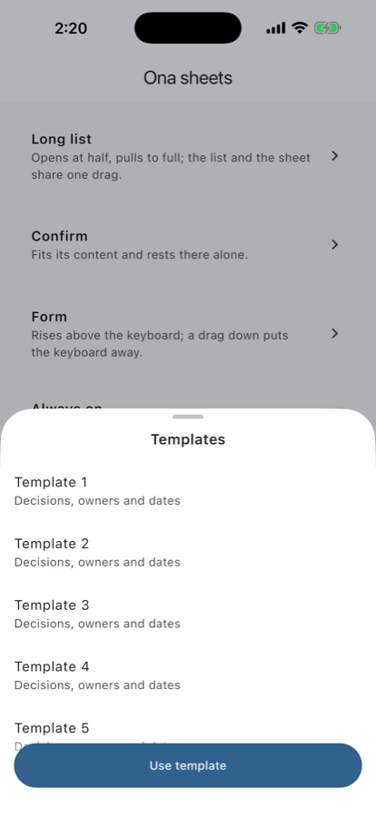
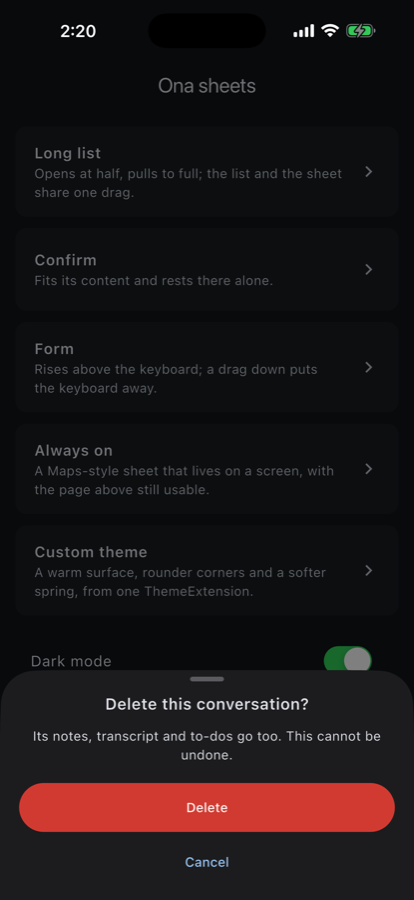
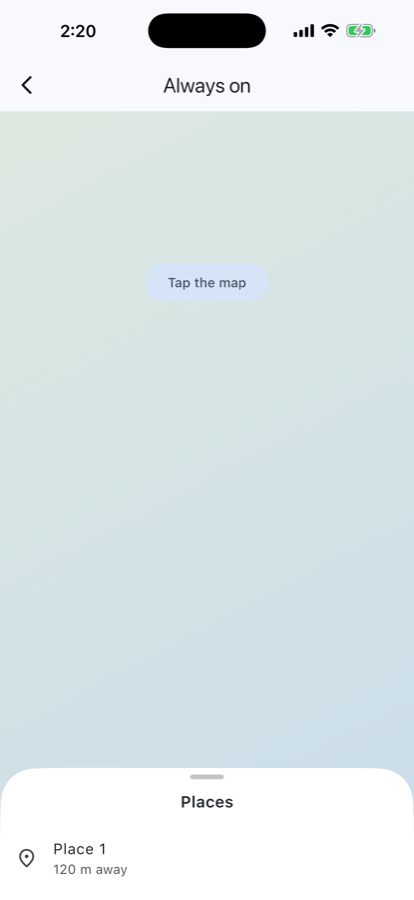

# ona_bottom_sheet

Bottom sheets for Flutter that move like the platform's own. Built and maintained by Ona.

<p>
  
  
  
</p>

- **Stops that adapt to content.** A sheet that fits on screen rests whole at its own height. A longer one opens at half and pulls up to full.
- **One drag for the list and the sheet.** Pulling up on the list grows the sheet first, then scrolls. Pulling down scrolls back to the top first, then lowers the sheet.
- **Motion that feels native.**
  - A non-bouncy 0.35 s spring.
  - Release speed is projected to choose a stop, so a slow release settles back and a flick carries on.
  - Drags follow the finger exactly once it has moved 10 pt.
  - A swipe down closes the sheet at the speed of the finger.
- **Calm with the rest of the app.**
  - The page behind is dimmed, never moved.
  - At full height, the sheet stops at the safe area.
  - Pulling past the top moves nothing.
  - The sheet rises above the keyboard, and a drag down puts the keyboard away.
- **Modal or always on.** `showOnaBottomSheet` shows a sheet modally. An `OnaSheetViewport` keeps one on a screen, the way Maps does, and the page above it stays usable.
- **Solid or liquid glass.** An opaque card, or glass that turns solid at full height, as on iOS. On iOS 26 and later the glass is Apple's own Liquid Glass.
- **Themed in one place.** Colours, corners, grabber, dimming, motion and style come from one `ThemeExtension`, with light and dark defaults.
- **Accessible.**
  - Screen readers name the sheet and can close it with their escape gesture.
  - The grabber is adjustable: swipe up or down to move between stops.
  - Removed animations are honoured, and right-to-left layouts work.
- **Light on the frame budget.** A drag moves render objects only and rebuilds no widgets. On an iPhone 16 Pro Max, every frame of open, drag, scroll and close stays inside the 8.3 ms a 120 Hz screen allows.

## Install

```yaml
dependencies:
  ona_bottom_sheet:
    git:
      url: https://github.com/ONA-AI-Labs/ona-bottom-sheet.git
      ref: v0.4.0
```

It needs Flutter 3.41 or later and has no dependencies beyond Flutter and `meta`. On iOS it brings a small plugin of its own, for Apple's glass; there is nothing to set up.

## Quick start

```dart
import 'package:ona_bottom_sheet/ona_bottom_sheet.dart';

final bool? deleted = await showOnaBottomSheet<bool>(
  context: context,
  builder: (context) => OnaBottomSheet(
    child: OnaSheetScaffold(
      header: const Column(mainAxisSize: MainAxisSize.min, children: [
        SizedBox(height: 7),
        OnaSheetGrabber(),
        SizedBox(height: 48, child: Center(child: Text('Delete this conversation?'))),
      ]),
      body: ConfirmButtons(),
    ),
  ),
);
```

`showOnaBottomSheet` returns what the sheet pops with. A sheet closes on a tap outside, a swipe down, the back gesture or a screen reader's escape. Pass `isDismissible: false` to keep it open: it still drags, then springs back. A `PopScope` inside the sheet can refuse to close while work is in flight.

## The pieces

| | |
|---|---|
| `showOnaBottomSheet` | Shows a modal sheet, styled and timed by the theme. |
| `OnaBottomSheet` | The sheet, with the defaults described above. Every default can be changed. |
| `OnaSheetScaffold` | Lays out a header, body and footer. `FooterVisibility.always(scrimColor: …)` keeps the footer in view at partial heights. |
| `OnaSheetGrabber` | The handle at the top. Screen readers can adjust it. |
| `OnaSheetViewport` | Keeps a sheet on a screen, with no route. |
| `SheetDetents` | Where a sheet rests: `.adaptive()` (the default), a list of `SheetOffset`s with an optional `flickProjection`, `.single`, or `.stepless`. |
| `SheetOffset` | A position: a fraction of the content (`SheetOffset(1)` is all of it), `.absolute(px)`, or `.proportionalToViewport(0.5)`. |
| `OnaSheetController` | Observe the sheet's position and move it with `animateTo`. |
| `OnaBottomSheetRoute`, `OnaBottomSheetPage` | Full control, and declarative navigation (`go_router` and other routers built on Navigator 2.0). |
| `RawSheet` | The unstyled engine underneath, for a look entirely your own. |

### An always-on sheet

```dart
Stack(children: [
  const MapView(),
  OnaSheetViewport(
    child: OnaBottomSheet(
      detents: const SheetDetents(
        snaps: [SheetOffset.absolute(140), SheetOffset.proportionalToViewport(0.5), SheetOffset(1)],
        flickProjection: 0.499,
      ),
      initialOffset: const SheetOffset.absolute(140),
      child: OnaSheetScaffold(header: header, body: placesList),
    ),
  ),
]);
```

### A list inside a sheet

Put any scroll view in the body. It shares its drag with the sheet automatically, because the sheet gives it a `PrimaryScrollController`. For exact 1:1 tracking, give the list `dragStartBehavior: DragStartBehavior.down`.

### Pull-to-refresh

Use `SheetScrollConfiguration(delegateUnhandledOverscrollToChild: true)` with elastic physics (`BouncingSheetPhysics`), so a `RefreshIndicator` receives the overscroll.

## Solid or liquid glass

```dart
OnaBottomSheetTheme.light.copyWith(style: const OnaSheetStyle.glass())   // every sheet
OnaBottomSheet(style: const OnaSheetStyle.glass(), child: ...)          // one sheet
```

`OnaSheetStyle.solid` is the default: an opaque card that costs nothing to draw.

`OnaSheetStyle.glass` shows the page behind through glass:
- **On iOS 26 and later it is Apple's Liquid Glass** (`UIGlassEffect`), the material of the system's own bars and
  sheets, with its blur, light rim and the lensing along its edges. iOS draws it behind the sheet's Flutter content,
  in the sheet's shape, light or dark to match the theme.
- Elsewhere (Android, iOS before 26, web, desktop) Flutter draws a frosted pane: the page is blurred (`blur`, sigma
  24), its colours are lifted (`saturation` 1.8), the theme's background is laid over it as a tint (`tintOpacity`
  0.62), and a light rim (`rimOpacity`) catches the top edge. These four values shape this pane only; Apple's glass
  is Apple's.
- `tint` colours the glass on every platform. Apple's glass takes it as its own tint colour, mixed into the material
  under its highlights; the Flutter pane lays it over the blur at `tintOpacity` in place of the background. Its alpha
  sets how strong it is. A mid-tone tint lowers the contrast of grey text on the sheet, so check it.
- As on iOS, the glass turns opaque as the sheet rises to its highest stop (`solidAtFull`). Once there, nothing behind
  it is drawn, so a full sheet costs what a solid one does.
- A sheet with a single stop stays glass.
- When the platform asks for high contrast, sheets are drawn solid. Apple's glass also follows Reduce Transparency.

How it stays fast:
- Apple's glass is told about the sheet only when its shape, its brightness or whether it shows changes, never per
  frame. iOS moves it with the sheet in the same frame.
- The Flutter pane has one backdrop filter, clipped to the sheet's shape. The filter is built once and every layer
  is reused from frame to frame.
- A drag or a scroll repaints and never rebuilds.

## Theming

```dart
MaterialApp(
  theme: ThemeData(extensions: [
    OnaBottomSheetTheme.light.copyWith(
      cornerRadius: 28,
      motion: const OnaSheetMotion(presentDuration: Duration(milliseconds: 420)),
    ),
  ]),
  darkTheme: ThemeData(brightness: Brightness.dark, extensions: [OnaBottomSheetTheme.dark]),
);
```

| Value | Default (light / dark) |
|---|---|
| `backgroundColor` | `#FFFFFF` / `#1C1C1E` |
| `barrierColor` | black at 28% / black at 50% |
| `cornerRadius` | 38 |
| `grabberSize`, `grabberColor` | 36 × 5, a translucent grey |
| `touchSlop` | 10 (iOS waits 10 pt; Flutter's default is 18) |
| `motion.settle` | `kOnaSheetSpring`: mass 1, stiffness 322.3, damping 35.9 (0.35 s, no bounce) |
| `motion.presentDuration` / `presentCurve` | 500 ms, `Cubic(0.32, 0.72, 0, 1)` |
| `motion.dismissDuration` | 300 ms |
| `motion.flickProjection` | 0.499 s, the travel a scroll view's normal deceleration gives a flick |
| `style` | `OnaSheetStyle.solid`, or `OnaSheetStyle.glass(...)` |

Without an extension, the light or dark default follows `ThemeData.brightness`.

## Accessibility

- The route names the sheet, using `semanticsLabel` or the platform's "bottom sheet" label. A dismissible sheet answers the screen reader's escape action.
- `OnaSheetGrabber` is adjustable: *increase* moves the sheet to its next stop up, *decrease* to the next stop down.
- When animations are removed (`MediaQueryData.disableAnimations`), sheets appear and go away instantly. Drags still follow the finger.

## Performance and memory

- While a sheet moves, only its render objects update. The footer's fade is drawn at paint time and rebuilds nothing.
- Every controller, listener and animation the package creates is disposed with its widget. The test suite runs with leak tracking on, and a leak fails the test that caused it.
- `example/lib/bench.dart` is the on-device frame bench used to measure a release (`flutter run --profile -t lib/bench.dart`).

## Quality

- 357 tests, at 90% line coverage. Leak tracking is on, and missed taps are fatal.
- Zero analyzer issues under strict rules (strict casts, inference and raw types, plus documentation on every public member).
- CI runs formatting, analysis, the tests with coverage, the example's tests and a web build of the example on every push.

The example app in `example/` is a tour of every sheet the package draws. Run it with `--dart-define=ONA_TOUR=true` and it walks through the demos by itself, in light and dark.

## License

MIT. See [LICENSE](LICENSE).
